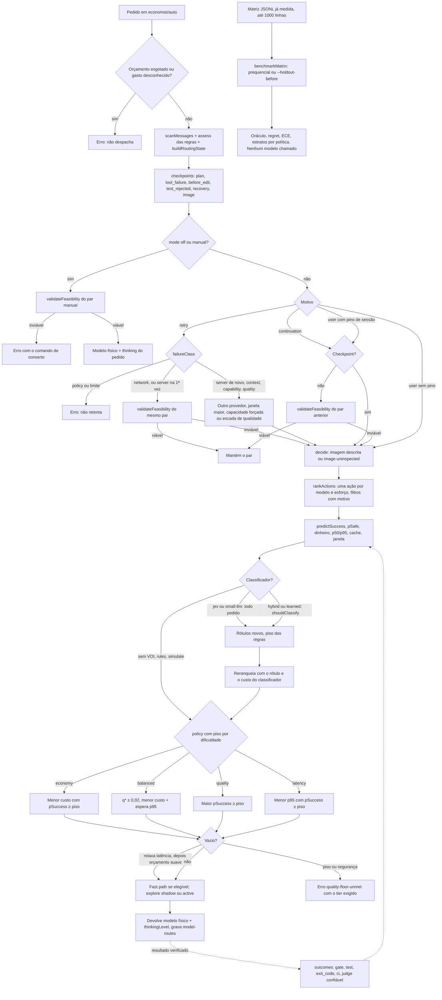

# Fluxo de decisão

## Camadas da versão 2.0

`context/runtime.mjs` conecta o Context Planner e o Economics Observer ao lifecycle do Pi 1.5.2. Contexto → artefatos/retrieval/checkpoint → topologia → `assess()` → `rankActions()` → política/hysteresis → Pi → usage/resultados verificados. A unidade pública `(model, effort)` e seus floors continuam. Quando a camada v2 está ativa, cache é parte do custo de input, sem subtrair a mesma economia duas vezes; em observe/advisory, a política legada continua como baseline. Proveniência, capacidades, presets, contratos de worker, avaliação pareada e gates estão em [v2.md](v2.md). As seções abaixo documentam o baseline preservado e as invariantes comuns.

A extensão não responde à tarefa. Ela escolhe a **ação** `(modelo físico, nível de esforço)` que o Pi vai usar naquele turno. O fluxo vive em `economist/auto` → `route()` (`extension.mjs`) → `decide()`. As regras e o classificador estão em `routing.mjs` (`assess`, `Classifiers`). O ranking, as políticas e o aprendizado estão em `decision.mjs` (`rankActions`, `predictSuccess`, `selectAction`). O benchmark offline está em `benchmark.mjs` (`benchmarkMatrix`).

Quatro eixos independentes. Nenhum deles é os outros.

| Eixo | Config | Valores |
| --- | --- | --- |
| Quando reavaliar | `cadence` | `session`, `prompt`, `subagent` |
| Como classificar a tarefa | `mode` | `hybrid`, `rules`, `jev`, `small-llm`, `learned`, `manual`, `off` |
| Como escolher entre as ações viáveis | `policy` | `economy`, `balanced`, `quality`, `latency` |
| Quais esforços viram ações | `thinking.mode` | `auto`, `follow`, `fixed` |

## Unidade de ranking

A unidade é a ação `(model, effort)`. Cada ação aceita carrega quantidades separadas. Nenhuma é convertida na outra:

| Campo | O que é |
| --- | --- |
| `pSuccess` | Probabilidade de sucesso verificado. Só `predictSuccess` produz esse número, e é o único gate que o ranking consulta. |
| `pSafe` | Probabilidade de sucesso em tarefas com risco. `null` abaixo de 20 amostras. |
| `predictedCostUsd` | Só dinheiro: API + classificador + recuperação esperada. |
| `policyCostUsd` | `predictedCostUsd` − economia de cache + perda de cache. Também só dinheiro. |
| `latency.p50Ms`, `latency.p95Ms` | Latência medida (≥ 5 amostras) ou o prior do candidato, mais o delta de TTFT. |
| `uncertainty` | Desvio-padrão da mistura que gerou `pSuccess`. |

`estimatedTotalCostUsd` no log é `policyCostUsd`: dinheiro, sem latência dobrada no custo. `latencyWeight` e `cacheSwitchPenalty` não existem mais.

## Quando uma decisão acontece

| Cadência | Comportamento |
| --- | --- |
| `session` | A primeira pergunta escolhe o par. Ele fica até `/model`, até um risco duro que o pino não cobria, ou até um checkpoint. Voltar para `economist/auto` escolhe de novo. |
| `prompt` (padrão) | Cada pergunta do usuário reavalia. Continuações mantêm o par se ele continuar viável e não houver checkpoint. |
| `subagent` | A sessão principal reavalia como `prompt`. Quem cria um filho chama `economist_subagent_model({ task, envelope })`. Sem `envelope`, a decisão sai com `degraded-subagent-context`. |

### Checkpoints

Antes de reaproveitar qualquer par, `route()` monta o `routingState` (`buildRoutingState`) e procura checkpoints (`checkpoints`). Um checkpoint força decisão completa:

| Checkpoint | Quando |
| --- | --- |
| `plan` | Intenção de design ou busca, sem ferramenta usada ainda. |
| `tool_failure` | Última ferramenta falhou e não foi teste. |
| `before_edit` | A tarefa vai editar e a última observação foi uma leitura bem-sucedida. |
| `test_rejected` | Último teste falhou. |
| `recovery` | A tentativa anterior terminou em `gate_rejected` ou `quality`. |
| `image` | A última mensagem do usuário trouxe imagem. |

### `validateFeasibility`

Todo par reaproveitado — continuação, pino de sessão, retry no mesmo par, modo `manual` ou `off` — passa por `validateFeasibility` antes de sair. A função não ranqueia. Ela só confere disponibilidade, auth, saúde, privacidade, imagem, tools, janela exigida, raciocínio exigido pelo risco e orçamento. Par inviável em `auto` vira decisão completa (`sticky-infeasible`, `session-pin-infeasible`). Em `manual` ou `off`, o erro nomeia o motivo e o comando de conserto (`/model`, `/compact`, `/login`, `/economist candidates add`).

### Retry por causa

`failureClass` classifica a mensagem de erro, nesta ordem:

| Causa | O que acontece |
| --- | --- |
| `context` | Exclui o modelo que estourou e exige janela ≥ a dele. Se ninguém comporta, emite `model.context_overflow` com `suggestCompaction` e o erro sugere `/compact`. |
| `policy` (401, 403, permissão, orçamento) | Não retenta. |
| `capability` (tools, imagem, modalidade) | Força a capacidade e exclui o modelo. |
| `server` (429, 503, overload) | Primeira vez: mesmo par. Depois: outro provedor no mesmo esforço (`provider-fallback`). |
| `network` (timeout, stream) | Mesmo par, se viável. |
| `quality` | Escada de qualidade: mais esforço no mesmo modelo; na segunda falha daquele modelo, o próximo tier. |

Pares já tentados (`triedPairs`) saem com `retry-excluded`. O limite continua `maxRetries`.

## Insumos e privacidade

`route()` monta texto (só mensagens de usuário), blocos de imagem, tamanho de contexto, varredura das mensagens (`scanMessages`: rodadas de ferramenta, última observação, arquivos tocados — contados, nunca guardados) e o estado anterior.

A fronteira de privacidade é `dataPolicy`, uma por destino:

| Destino | Config | Padrão |
| --- | --- | --- |
| Classificador | `classifier.dataPolicy` | `redact` |
| Executor | `executor.dataPolicy` | `allow` |
| Telemetria | `telemetry.dataPolicy` | `redact` |

`deny` manda só enums, contagens e ids. `redact` passa por `redact()` (segredos, e-mail, telefone) e `scrubEntropy()` (trechos de alta entropia). `allow` ainda passa por `redact()`. Prompt de sistema bruto, stdout de ferramenta e bytes de imagem não entram no Jev, no small-LLM nem no log. O trecho da última observação no `routingState` é redigido; em `telemetry.dataPolicy: deny` vira hash.

### Imagem

| `classifier.imageDescriber.mode` | Efeito |
| --- | --- |
| `off` (padrão) | Sinal `image-uninspected`: dificuldade mínima `moderate`, risco semântico ativo, fast path bloqueado. |
| `local` | Chama o descritor injetado. A legenda redigida entra em `assess` como fonte `caption`. |
| `authorized-remote` | Só com `allowRemote` e `dataPolicy: allow`. Caso contrário, `image-describer-blocked`. |

Descritor de imagem, embedder e judge são interfaces injetáveis. Todos começam desligados.

## Regras locais

`assess()` roda sempre e de graça. Além dos campos legados (`kind`, `difficulty`, `risks`, tokens), devolve `features` (`RoutingFeatures`):

- **Intenções multi-rótulo** (`intents`): `explain`, `search`, `read`, `edit`, `test`, `debug`, `design`, `execute`, `incident`.
- **Texto normalizado** (`normalizeText`): sem caracteres invisíveis, leetspeak desfeito, letras soletradas juntadas.
- **Risco** com fonte e confiança:
  - `deterministic`: termo ou frase com fronteira de palavra.
  - `context`: follow-up curto ou anafórico herda o risco anterior.
  - `caption`: risco visto na legenda da imagem.
  - `semantic`: 0,45 se só mencionado ou negado; 0,7 se só casa com o texto espremido (`drop_table`).
  - Só as três primeiras fontes são risco duro.
- **Impacto e reversibilidade** do risco (`riskImpactOf`).
- **Capacidades** por intenção (`fileRead`, `fileWrite`, `shell`, `web`, `image`).

A chave da família é `${kind}|risk:${impact}|tools:..|image:..`. O Beta próprio de uma ação é indexado por família + modelo + versão + esforço.

## Classificador

| Modo | Quando chama |
| --- | --- |
| `rules` | Nunca. |
| `jev`, `small-llm` | Todo pedido elegível, inclusive saudação e risco duro. |
| `hybrid`, `learned` | Só quando `shouldClassify` diz que a informação vale o preço. |
| `manual`, `off` | Nunca. |

`shouldClassify` (valor da informação) testa rótulos plausíveis (`labelAlternatives`). Se nenhum rótulo muda o modelo vencedor, pula com `classifier-skipped-no-voi`. Se algum muda, chama quando a margem de utilidade é menor que `minUtilityMargin` (0,05), a diferença de custo é material (`materialCostGap`, 25%), ou um rótulo cruza tier/capacidade. Também exige que a perda evitada pague preço + espera.

Jev e small-LLM respondem também `intents`, `riskImpact` e `reversibility`. O piso das regras continua: risco, tools e imagem só sobem. Com `stats.applyCalibration`, a confiança do classificador passa pela calibração e precisa de `minCalibratedProbability` (0,6).

No log: `classifierConsidered`, `classifierCalled`, `classifierEngine`, `classifierConfidence`, `classifierChangedRoute`, `classifierCost`, `classifierLatencyMs`, `routeWithoutClassifier`, `routeWithClassifier`, `classifierWasCorrect`, `classifierRoiUsd`.

## Ações

| `thinking.mode` | Ações por modelo |
| --- | --- |
| `auto` | Uma por nível suportado até `ceiling`. |
| `follow` | Uma: o nível do `/thinking`. |
| `fixed` | Uma: `thinking.fixed`. |
| Ás de escopo (`modelo:high`) | Uma: aquele nível. |

`rankActions` rejeita, com motivo, antes de qualquer preferência: `virtual`, `authentication`, `unverified-tier`, `tier`, `health`, `tool-compatibility-unverified`, `image`, `privacy`, `retry-excluded`, `not-fallback-provider`, `context`, `reasoning-unavailable`, `unsafe`, `budget`.

**Guardrail de raciocínio.** Com risco duro e `pSafe` nulo (menos de 20 amostras), só ações que raciocinam passam. Com ≥ 20 amostras, `pSafe` precisa ser ≥ `safetyThreshold` (0,9).

## Papéis e preferências de modelo

O papel é derivado da intenção principal da chamada: `design`, `search`, `read` e `explain` usam Planejador; `test` usa Revisor; as demais intenções usam Executor. Os papéis são atalhos de intenção e não adicionam modelos ao pool.

`/economist role <papel> model <provider/model>` grava uma preferência por papel. O modelo precisa estar no conjunto aprovado e, com `/scoped-models`, dentro do escopo ativo. `/economist role <papel> effort <nível>` prefere um esforço quando o modo global está em `auto`; `effort auto` limpa essa preferência. `follow`, `fixed` e um nível fixado pelo escopo têm prioridade. A seleção continua sujeita a capacidade, tier, privacidade, janela, risco, preço e orçamento. Sem uma ação viável que satisfaça a preferência, o padrão é interromper com uma orientação; `/economist role <papel> fallback on` permite escolher outra ação viável e a decisão registra o fallback. Desativar o fallback volta a exigir a preferência viável.

A preferência só afeta a próxima decisão que corresponder ao papel. Salvar configuração não chama `setModel`, não altera uma chamada em andamento e não muda o estado de outras sessões ou filhos já iniciados. Modelo sem preço continua com custo desconhecido; um orçamento rígido recusa essa ação em vez de tratá-la como custo zero.

## `predictSuccess`

Mistura ponderada por precisão:

| Componente | Peso |
| --- | --- |
| Beta próprio da ação na família (α 1, β 3, meia-vida 30 dias) | n |
| Mesma ação em famílias com intenção em comum | 0,5 · n |
| Vizinhos do embedder (cosseno ≥ 0,85, só com `learned.embeddings: on`) | 0,25 · n |
| Prior do tier: 0,62 / 0,74 / 0,84 / 0,88 / 0,91, teto 0,97 | α + β |
| Bradley-Terry (`learned.preference`, ≥ 20 pares) | pares |

Só resultados verificados entram: `gate`, `test`, `typecheck`, `exit_code`, `ci`, `file_diff` e `judge` confiável (`verifiers.trustedJudges`). O que o modelo diz de si mesmo não entra. Esforço mais alto que também passou na mesma tarefa é marcado `dominated`.

Com `stats.applyCalibration` (desligado por padrão), `pSuccess` passa pelos bins de calibração.

## Dinheiro, tokens e janela

- **Tokens** por ação: p50/p95 medidos (≥ 5 chamadas) ou o prior `thinking.outputTokens`. Sem divisão de raciocínio no uso, todo output conta como visível (`reasoning-not-split`).
- **Preço:** `cost.reasoning` quando publicado; senão o preço de output (`reasoning-price-shared`). Cache sem preço publicado vale zero (`cache-unpriced`). TTFT sem medição vale zero (`ttft-unpriced`). Nenhuma tarifa é inventada.
- **Janela exigida:** entrada + p95 de raciocínio + p95 visível + 2048 se agêntica + margem 512. Contagem pelo tokenizer quando há; senão `/4` com `token-estimate-fallback`.
- **Recuperação:** `expectedRetries = pFail / (1 − pFail)`. O custo de recuperação usa a próxima ação da escada (`recoverySource: next-action`).

## Políticas

Piso de qualidade por dificuldade: trivial 0,45, simple 0,55, moderate 0,70, complex 0,80, critical 0,88. `qualityFloorOverride` (em `decide()` e `simulate --floor`) aceita valores em (0, 1].

| Política | Escolhe |
| --- | --- |
| `economy` | Menor `policyCostUsd` entre as ações com `pSuccess` ≥ piso. |
| `quality` | Maior `pSuccess` ≥ piso. Custo só desempata. Teto opcional `objectives.quality.latencyCapMs`. |
| `latency` | Menor p95 ≥ piso. |
| `balanced` | q* = maior `pSuccess` viável. Entre as ações a até `successTie` (0,02) de q*, menor custo + p95 × `latencyValueUsdPerSecond` (0,01). `softBudgetUsd` e `targetLatencyMs` opcionais. |

Relaxamento: primeiro a latência, depois o orçamento suave. O piso e o `safetyThreshold` nunca relaxam. O log grava `policyResult`: `selected`, `relaxed-latency`, `relaxed-budget` ou `quality-floor-unmet`.

## Fast path

Liga quando não há risco duro, risco semântico, risco de contexto, imagem não inspecionada, falha recente de ferramenta, gate reprovado, checkpoint nem escalonamento. O conjunto rápido são as ações até o tier da mais barata, com `pSuccess` ≥ piso + `successMargin` (0,05). Se o classificador custou mais do que o fast path economiza, sai `fast-path-not-worth-classifier`. Falha verificada de gate na fase `fast` escala uma vez (`maxEscalations`).

## Exploração

`explore` soma `kappa · uncertainty` (0,15) à utilidade. Ela só considera ações até `maxExplorationPremium` (10%) mais caras e nunca explora com risco duro. Explora no máximo uma vez por família por sessão. Em `learned.deployment: shadow` (padrão), a escolha exploratória só é registrada (`shadowChoice`); em `active`, ela é despachada. A regra antiga "a cada 20 linhas" foi removida.

## Benchmark offline

`/economist benchmark --dataset matriz.jsonl [--holdout-before ISO] [--policy POLÍTICA]` lê uma matriz já medida: cada linha é uma tarefa com `actions[]` (`model`, `effort`, `tier`, `success`, `costUsd`, `latencyMs`). No máximo 1000 linhas. Nenhum modelo é chamado.

- Sem `--holdout-before`: avaliação prequencial; cada linha é prevista só com as anteriores.
- Com `--holdout-before`: treina nas linhas anteriores à data e avalia as seguintes.

Por política: taxa de sucesso, custo total e médio, custo por sucesso, p50/p95, oráculo (melhor ação realizada daquela linha), regret, concordância com o oráculo, base "mais forte", economia com intervalo de confiança, Brier, ECE, bins de calibração, distribuição de modelos e esforços, e estratos por dificuldade, risco e tipo. Dataset sem `actions` usa o replay pareado legado.

## Explain e log

`/economist explain` mostra modelo e esforço, motivo, tarefa, `pSuccess` e piso, `pSafe`, p50, p95, custo previsto, custo e ROI do classificador, termos de cache, `finalOutcome` e a calibração (ECE).

`model-routes` grava a decisão com: `action`, `features`, `routingState`, `pSuccess`, `pSafe`, `predictedCostUsd`, `latencyP50Ms`, `latencyP95Ms`, `latencySource`, `expectedRetries`, `expectedRecoveryCostUsd`, `recoverySource`, `expectedCacheSavingsUsd`, `expectedCacheLossUsd`, `expectedTtftDeltaMs`, `uncertainty`, `qualityFloor`, `policyResult`, `effortSource`, `checkpoint`, `feasibility`, campos do classificador, `shadowChoice`, `exploreChoice`, `productionChoice`, `reasoningProfile`, `finalOutcome` e os candidatos com flags. `route-outcomes` liga cada resultado verificado à decisão.

## Fluxo

